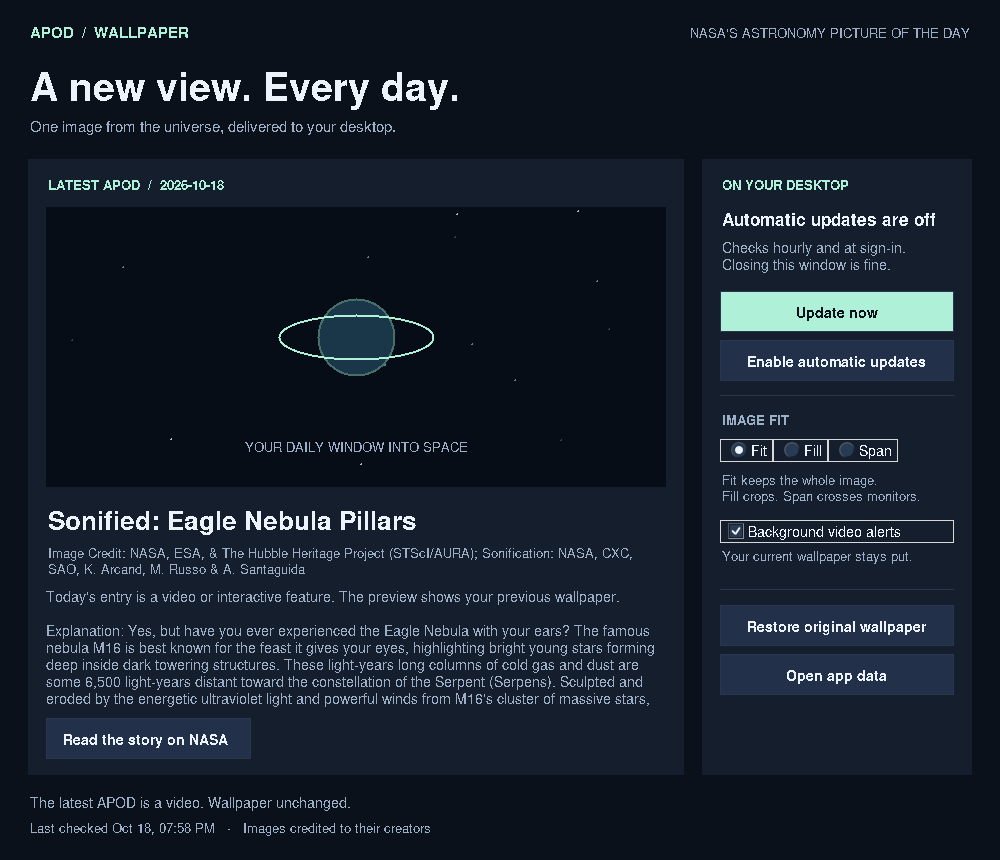

# APOD Wallpaper

A small Windows desktop app that puts NASA's Astronomy Picture of the Day on
your wallpaper. Video days keep your existing wallpaper, with an optional
popup linking to the entry.

**Version 1.0.1 — Windows source release.** Python 3.11 or newer is required.
Includes source code and a per-user installer. A standalone EXE is not included.



## Get started

1. Extract the ZIP completely. Do not launch files from inside the ZIP viewer.
2. If needed, install [Python for Windows](https://www.python.org/downloads/windows/).
   Keep Tcl/Tk enabled. Python 3.12 or 3.13 is a straightforward choice.
3. Double-click **Install.cmd**. Setup creates a private Python environment,
   installs Pillow and truststore, adds Desktop and Start menu shortcuts, and registers
   automatic checks for your Windows account. Internet access is needed.
4. The app opens and makes its first update. Open **APOD Wallpaper** from the
   shortcut whenever you want to change settings.

Run setup as your normal Windows user. No API key, account, password, or
administrator installation is needed. A school or company-managed computer
may restrict Task Scheduler; if so, manual updates still work.

**Updating from 1.0.0:** Close the old app window, extract the new download into
a new folder, and run its Install.cmd. There is no need to uninstall. Your
settings, cached images, and original-wallpaper backup are preserved. The new
window title says **APOD Wallpaper 1.0.1**.

## What it does

- Checks NASA at sign-in and hourly while your account is signed in.
- Changes your wallpaper only for a new image, or when you click **Update now**.
- Leaves your wallpaper alone on video/interactive days and on download errors.
- Validates and decodes the entire image before calling the Windows wallpaper API.
- Keeps the whole image by default (**Fit**). **Fill** crops to the screen;
  **Span** spreads one image across monitors.
- Saves a copy of the original wallpaper and its fit settings before the first change.
- Keeps up to seven APOD images locally and rotates its diagnostic log.
- Offers an optional video-day popup with an **Open today's APOD** button.
  The popup closes after one minute and is shown at most once per entry after
  a successful background notification. **Background video alerts** controls
  automatic popups; a manual **Update now** always offers the video link.

You can close the app window. Windows Task Scheduler performs the checks;
there is no permanently running background service. The task does not wake
your computer. A missed check runs when Windows next schedules it after you
return. If NASA has not posted a newer entry yet, the existing image stays.

**Pause automatic updates** stops future checks. An update already in progress
may finish. **Restore original wallpaper** pauses updates and restores the
saved image and fit setting. The baseline is captured before the first wallpaper
replacement. Restoring clears that baseline; the next replacement captures a
new one. Windows slideshow/Spotlight modes, distinct images per monitor, and full
theme restoration are outside this version's scope.

The preview shows the last APOD image applied by the app. On video days, the
previous image remains visible. A planet placeholder appears if no usable APOD
image has been saved yet.

## Uninstall

To return to your old wallpaper, first use **Restore original wallpaper**.
Then close the app and run **Uninstall.cmd**. It removes the scheduled task
and shortcuts. It deliberately keeps the app data and current image so Windows
is not left pointing at a deleted wallpaper.

For complete removal, choose another wallpaper in Windows Settings and delete
`%LOCALAPPDATA%\APODWallpaper` after all APOD windows have closed. You can also
find Uninstall.cmd inside that folder's `app` subfolder.

## Where files live

Everything is local to `%LOCALAPPDATA%\APODWallpaper`:

| Item | Purpose |
| --- | --- |
| `app/` | Installed source code |
| `venv/` | Private Python environment |
| `images/` | Validated APOD JPEGs |
| `original-wallpaper.*` | Backup of the pre-APOD wallpaper |
| `settings.json` | Fit, notification preference, cache limit |
| `state.json` | Latest entry, applied image, original settings |
| `app.log` | Bounded diagnostic log |
| `diagnostics.txt` | Report from Diagnose.cmd, when run |

The app makes HTTPS requests to NASA's public feed and its image URLs.
There is no analytics, telemetry, hosted backend, or upload of your wallpaper.
Do not commit your local data folder to GitHub.

## Running from source

From a terminal in this folder:

```powershell
py -3 -m venv .venv
.venv\Scripts\python.exe -m pip install -r requirements.txt
.venv\Scripts\python.exe -m apod_wallpaper
```

Use the installer for a stable installation path before enabling automation.

```powershell
# Read NASA metadata without changing the wallpaper (also works on Linux/macOS).
.venv\Scripts\python.exe -m apod_wallpaper --check

# One wallpaper update, without installing a task.
.venv\Scripts\python.exe -m apod_wallpaper --once

# Run the offline automated tests.
.venv\Scripts\python.exe -m unittest discover -s tests -v
```

Other switches: `--enable`, `--disable`, `--remove-task`, `--restore`, `--diagnose`,
`--preview`, and `--data-dir PATH`. `--background` is for Task Scheduler.
`--preview` opens read-only controls and makes no network or wallpaper changes.

## Troubleshooting

- **Python not found:** Install Python with Tcl/Tk, then reopen Install.cmd.
  The installer tries both the `py` launcher and `python` command.
- **NASA is unavailable:** Your wallpaper stays intact. Try Update now later,
  or let the next hourly check retry.
- **A connection error persists:** Run **Diagnose.cmd** from the new download
  after installation. It checks the feed and, on image days, the image download
  without changing your wallpaper. The result is also saved as `diagnostics.txt`
  in the app data folder. Share that report to identify the failing step.
- **Automatic updates are off:** Click Enable automatic updates. If Windows
  rejects the task, open app data and inspect app.log. Do not run under a different
  administrator account; that would configure the wrong user's wallpaper.
- **The app seems stuck:** A slow request can take a minute or more, including
  its retry. The UI remains responsive. Check app.log if it persists.
- **Windows keeps replacing the image:** Disable a competing wallpaper app,
  slideshow, or Spotlight background in Windows Personalization settings.
- **A settings/state file is unreadable:** The app stops rather than silently
  discarding the saved original wallpaper. Back up the file before repairing it.

## Technical notes

The current public feed is
`https://science.nasa.gov/wp-json/wp/v2/apod-basic?per_page=1`.
The app chooses the latest dated record returned by the feed, rather than
guessing the APOD date from the computer's local time. The feed currently
returns a list. In the newer response format, `url` may be the article page;
`hdurl` supplies the image. The parser also supports the legacy object format.

Version 1.0.1 requests only the newest record, reducing the metadata download.
HTTPS uses truststore's native system certificate verification (CryptoAPI on
Windows), with hostname checking enabled. A temporary timeout, connection reset,
or server error gets one retry. Certificate failures, access denials, and rate
limits are reported without repeated requests. The error identifies the failed
host and actual reason instead of treating every failure as an offline computer.

Project structure:

| File | Responsibility |
| --- | --- |
| `core.py` | NASA client, metadata parsing, image validation, update decisions |
| `storage.py` | Settings, atomic JSON writes, process lock |
| `windows.py` | Windows wallpaper API and per-user scheduled task |
| `gui.py` | Tkinter window, background worker, video popup |
| `diagnostics.py` | Connection checks and diagnostic reports |
| `__main__.py` | GUI/command-line entry point |
| `install.py` | Per-user setup and shortcuts |

See [Architecture](docs/ARCHITECTURE.md) for the update flow and state handling,
[Testing](docs/TESTING.md) for coverage and Windows integration checks, and
[Changelog](docs/CHANGELOG.md) for release changes.

## Credits and source documentation

- [NASA APOD API documentation](https://github.com/nasa/apod-api)
- [NASA APOD](https://science.nasa.gov/apod/)
- [Windows SystemParametersInfoW](https://learn.microsoft.com/en-us/windows/win32/api/winuser/nf-winuser-systemparametersinfow)
- [Windows Task Scheduler schema](https://learn.microsoft.com/en-us/windows/win32/taskschd/task-scheduler-schema)
- [Python Tkinter](https://docs.python.org/3/library/tkinter.html)
- [Pillow](https://pillow.readthedocs.io/)
- [Truststore](https://truststore.readthedocs.io/)

This is an independent application, not a NASA product. Individual APOD images
can have their own copyright holders; credits are displayed in the app.
Downloaded photos are not bundled in this source release.
